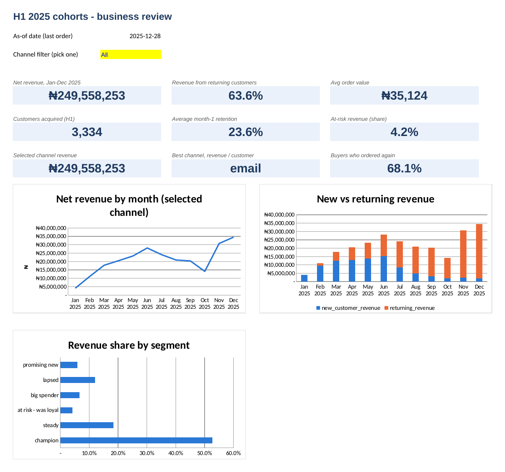
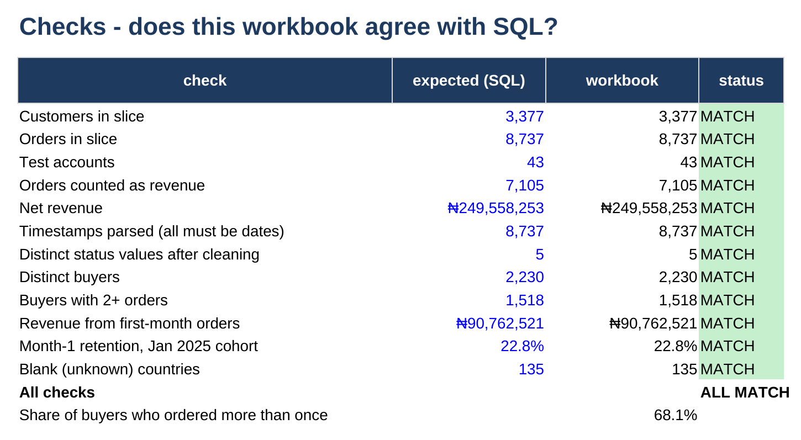

# Project 0 — Excel business review

**[⬇ Download the workbook](business_review.xlsx)** (2.9 MB, opens in Excel 2019+, Excel 365, or LibreOffice)

**Question:** of the customers acquired in the first half of 2025, how many are
still buying, who is worth saving, and is growth coming from new customers or
returning ones?

**Answer.** The 3,334 customers acquired January–June 2025 generated
**₦249.6m** of net revenue through December. **63.6%** of it came from
customers on a repeat purchase, and **68.1%** of buyers ordered more than once.
But average month-1 retention is only **23.6%**: three in four new signups do
not buy again the following month. The champion segment (533 customers) is
**52.7%** of the cohort's revenue, and email brings in the most valuable
customers per head.



And the proof: the Checks sheet recomputes 12 figures independently in SQL and compares them with the workbook.



---

## Why an Excel project in a SQL and Python portfolio

Because most analyst jobs list Excel first, and because most of the people who
will read your work open it in Excel. This workbook shows the same analysis as
projects 1 and 3 — cleaning, monthly revenue, cohort retention, RFM segments —
built from formulas a reviewer can click into and audit.

It also shows the judgement of **where Excel stops**. This slice is 8,737
orders. The full warehouse is 31,000 orders and 60,000 line items, and some of
the formulas here (the distinct-count trick in `Clean_Orders` column N) slow
down quadratically as rows grow. That is the honest reason the bigger projects
use SQL.

## What is in the workbook

| Sheet | What it does |
|---|---|
| **README** | Question, data, flow, colour key, cleaning rules, and when not to use Excel |
| **Dashboard** | Nine KPI tiles, three charts, and a **channel picker** (data validation dropdown) that filters the monthly chart |
| **Monthly** | Revenue, orders, distinct buyers, new vs returning, AOV, month-on-month growth |
| **Cohorts** | Retention triangle with censored cells left **blank, not zero**, and a colour scale |
| **Segments** | RFM segments with a recommended action per row |
| **Channels** | Acquisition channel quality: conversion and revenue per customer |
| **Checks** | **12 numbers reconciled against SQL. All show MATCH.** |
| **Customers** | One row per customer: cleaned fields, lifetime metrics, R/F/M scores, segment |
| **Clean_Orders** | One row per order: parsed dates, cleaned status, every analysis flag |
| **Raw_Customers / Raw_Orders** | The export exactly as received, warts included. Never edited. |
| **Pivot_Guide** | Click-by-click steps to rebuild the analysis with PivotTables and Power Query |

**182,043 formulas, zero errors.** Every number you see is a live formula over
the raw sheets: change a raw value and the workbook recalculates.

## Techniques worth pointing at

**Cleaning with formulas, never by hand.** Raw sheets are pasted exactly as
exported and are never edited. Every fix lives in a formula on a separate sheet,
so the cleaning is visible, repeatable, and reversible.

| Problem in the raw data | Formula that fixes it |
|---|---|
| Status in 8 spellings (`Completed`, `COMPLETED`, ...) | `=LOWER(TRIM(...))` → 5 clean states |
| Timestamps in two formats (`2025-03-04 19:22:00` and `04/03/2025 19:22`) | One `IF(MID(x,5,1)="-", DATE(...), DATE(...))` that parses both |
| Emails with stray capitals and spaces | `=LOWER(TRIM(...))` |
| Blank countries | `=IF(TRIM(x)="","unknown",TRIM(x))` so they survive every summary |
| Internal test accounts | `=ISNUMBER(SEARCH("@test.internal",email))` → flagged and excluded, not deleted |

**Lookups with `INDEX`/`MATCH`**, not `VLOOKUP`: they don't break when someone
inserts a column, and they can look left.

**Distinct counts with an expanding range.**
`=COUNTIFS($B$2:B2, B2, $D$2:D2, D2) = 1` is TRUE only the first time a
customer appears in a month. Summing those TRUEs gives distinct buyers per
month — something a plain `COUNTIFS` gets wrong, because it counts orders.

**RFM without `NTILE`.** Each score is
`1 + INT(5 × share of buyers who are worse)`. Ties always share a score, which
makes it deterministic — the property the SQL project had to fix by adding a
tiebreaker.

**Censoring handled explicitly.** A cohort that has not had six months yet gets
a blank month-6 cell, computed from the data's end date. A zero there would read
as total churn.

**Reconciliation.** The `Checks` sheet compares twelve workbook numbers against
the same numbers computed independently in SQL by `build_workbook.py`. Two
independent calculations agreeing is the cheapest real proof that either one is
right. It caught a bug during the build: a helper row had been written on top of
the last check, and that row showed CHECK instead of MATCH until it was moved.

**A colour convention.** Blue text is a hardcoded input, black is a formula,
green is a link to another sheet, and yellow fill marks the one control a reader
should touch. This is the standard convention in finance and consulting
workbooks.

## Honest limitations

- **No native PivotTables.** The workbook is generated by `openpyxl`, which
  cannot write PivotTables, so everything is formulas. `Pivot_Guide` shows how to
  rebuild it with PivotTables in about ten minutes — worth doing yourself.
- **Item-level cleaning happens upstream.** Order revenue arrives already rolled
  up from line items, with duplicate rows removed and price typos excluded. That
  work is in the SQL project. This workbook starts at order level.
- **No marketing spend**, so the Channels sheet ranks customer quality, not
  return on spend.
- **Synthetic data**, like the rest of the portfolio.
- **RFM scores differ slightly from the SQL project**, because ties are grouped
  here and split by tiebreaker there. Both are documented.

## Rebuild it

```bash
make data warehouse                                       # from the repository root
python 00-excel-business-review/build_workbook.py --db warehouse.duckdb
```

The workbook is generated, not hand-built, so it can be rebuilt identically when
the data changes and every formula is reviewable as code.
